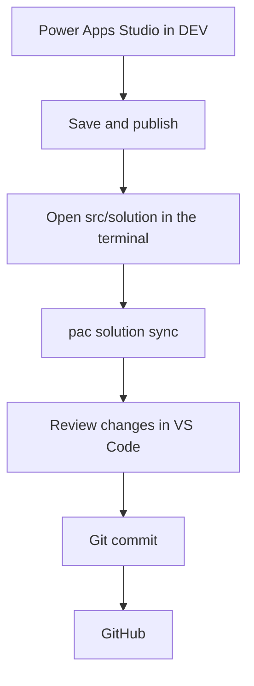
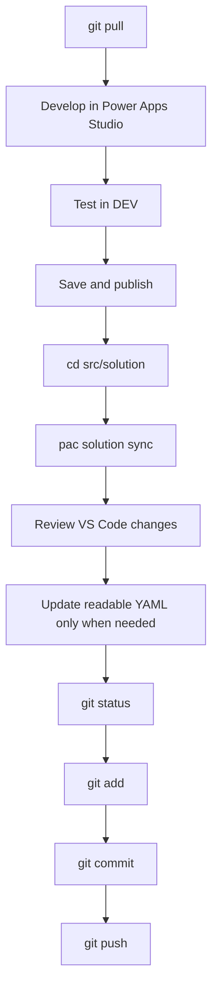

# Development workflow

## Purpose

Build and test the application in Power Apps Studio. Use PAC CLI to copy the current DEV solution into `src/solution/`. Use Git and GitHub to review, record and share changes.

This is intentionally a beginner workflow. It does not deploy changes from Git back into Power Platform.



## Repository areas

- `docs/` contains project documentation.
- `src/solution/` contains the Power Platform solution project created and updated by PAC CLI.
- `src/canvas-yaml/` contains readable Canvas YAML and important Power Fx copied for review and GitHub Copilot assistance.
- `src/canvas-yaml/app/` contains app-level formulas such as `App.OnStart.fx` and `App.Formulas.fx`.
- `working/input/` contains temporary material given to GitHub Copilot for troubleshooting.
- `working/output/` contains temporary proposed corrections for review.

`src/solution/` and `src/canvas-yaml/` have different purposes. PAC CLI synchronises `src/solution/`. It does not update the separate readable files under `src/canvas-yaml/`.

Do not store passwords, tokens, credentials or sensitive business data in this repository.

## Before starting

Install:

- Git
- Visual Studio Code
- [Microsoft Power Platform CLI](https://learn.microsoft.com/en-us/power-platform/developer/cli/introduction)

The Power Platform Tools extension for VS Code is optional.

## Starting a new Power Platform project

1. Create a new GitHub repository from the Power Platform template.
2. Clone the new repository to the computer.
3. Open the repository folder in VS Code.
4. Complete the basic documents under `docs/`.
5. In the DEV environment, create an unmanaged Power Platform solution.
6. Create the Canvas App inside that solution, or add the app and related components to it.
7. Develop and test the app in Power Apps Studio.
8. Save and publish the app.
9. Use PAC CLI to bring the solution into `src/solution/`.
10. Review, commit and push the generated changes.

## Starting with an existing application

1. Create a project repository from the Power Platform template.
2. Clone it and open it in VS Code.
3. Document the existing application's purpose, business rules and data sources under `docs/`.
4. In DEV, find or create an unmanaged solution.
5. Add the existing Canvas App and relevant components to the solution. Do not recreate the app.
6. Save and publish the app.
7. Use PAC CLI to bring the solution into `src/solution/`.
8. Optionally copy useful readable Canvas YAML and Power Fx into `src/canvas-yaml/`.
9. Review, commit and push the initial project snapshot.

Using a Power Platform solution does not mean the app's business data must be stored in Dataverse. The Canvas App can continue using SharePoint or other supported data sources.

## PAC CLI: first-time setup

Open the VS Code terminal at the repository root, where `README.md` is located.

### 1. Check authentication

```powershell
pac auth list
```

Check that the active profile points to the correct DEV environment.

If authentication is needed:

```powershell
pac auth create --environment "<ENVIRONMENT_URL>"
```

Replace `<ENVIRONMENT_URL>` with the actual DEV environment URL.

### 2. Check or select the DEV environment

```powershell
pac org list
```

If required, select DEV:

```powershell
pac org select --environment "<ENVIRONMENT_URL>"
```

Always confirm that DEV is selected before retrieving a solution.

### 3. Go to the solution source folder

From the repository root:

```powershell
cd src/solution
```

### 4. Bring the solution down for the first time

Run the first-time clone command used for this project:

```powershell
pac solution clone --name "<SOLUTION_UNIQUE_NAME>"
```

Replace `<SOLUTION_UNIQUE_NAME>` with the solution's unique name, not its display name.

Run this only when `src/solution/` has not yet been set up as a local solution project. Review where PAC creates the generated solution project before committing it.

## PAC CLI: normal solution sync

After the first-time setup, the normal workflow is much shorter.

1. Make changes in Power Apps Studio.
2. Save and publish the changes in DEV.
3. In the VS Code terminal, go to the local solution project under `src/solution/`.
4. Run:

```powershell
pac solution sync
```

Microsoft describes this command as synchronising the current local solution project with the current state of the solution in the selected environment.

After the sync, return to the repository root if needed:

```powershell
cd ../..
```

Then review the changes in VS Code Source Control.

Important:

- Run `pac solution sync` from the local solution project created by PAC, not from an unrelated folder.
- Save and publish intended DEV changes before synchronising.
- Check the selected PAC environment before synchronising.
- Review changed and deleted files before committing.
- `pac solution sync` updates `src/solution/`; it does not update `src/canvas-yaml/`.

See the [Microsoft PAC solution command reference](https://learn.microsoft.com/en-us/power-platform/developer/cli/reference/solution) for current options.

## Readable Canvas YAML and Power Fx

The PAC-generated solution source and manually copied Canvas files solve different problems:

```text
src/solution/
    Full solution project synchronised by PAC CLI

src/canvas-yaml/
    Readable Canvas YAML and Power Fx used for review and Copilot assistance
```

When useful, copy readable material from Power Apps into files such as:

```text
src/canvas-yaml/app/App.OnStart.fx
src/canvas-yaml/app/App.Formulas.fx
src/canvas-yaml/HomeScreen.yaml
src/canvas-yaml/Header.component.yaml
```

These reference files do not automatically synchronise with Power Apps. Review suggested changes and manually apply approved changes in Power Apps Studio, then save and test the app.

## Git basics

Run Git commands from the repository root.

### Check changes

```powershell
git status
```

### Download shared changes

Use this at the beginning of work when the local working tree is clean:

```powershell
git pull
```

### Stage reviewed changes

```powershell
git add .
```

### Commit locally

```powershell
git commit -m "Describe the change"
```

Use a short message describing what changed, for example:

```powershell
git commit -m "Sync latest DEV solution"
```

### Push to GitHub

```powershell
git push
```

If Git reports a conflict or unexpected history, stop and review the message. Do not force-push or discard work just to remove the error.

## Normal development cycle



Beginner checklist:

1. Start from the repository root.
2. Run `git status` and confirm there is no unfinished work.
3. Run `git pull`.
4. Make and test changes in Power Apps Studio.
5. Save and publish in DEV.
6. Change directory to the PAC solution project under `src/solution/`.
7. Run `pac solution sync`.
8. Review every change in VS Code Source Control.
9. Update `src/canvas-yaml/` only when deliberately required.
10. Run `git status`.
11. Run `git add .`.
12. Commit with a meaningful message.
13. Run `git push`.

## Troubleshooting with GitHub Copilot

For a small Power Fx or YAML problem:

```text
Power Apps
    ↓
Copy the problem into working/input/
    ↓
Ask GitHub Copilot to analyse it
    ↓
Put a larger proposed correction in working/output/ when useful
    ↓
Review the proposal
    ↓
Apply the approved change manually in Power Apps
    ↓
Save and test
    ↓
Synchronise the solution when ready
```

Asking GitHub Copilot to check or troubleshoot a file does not automatically authorise changes to preserved files under `src/`. Ask explicitly if an original file should be edited.
