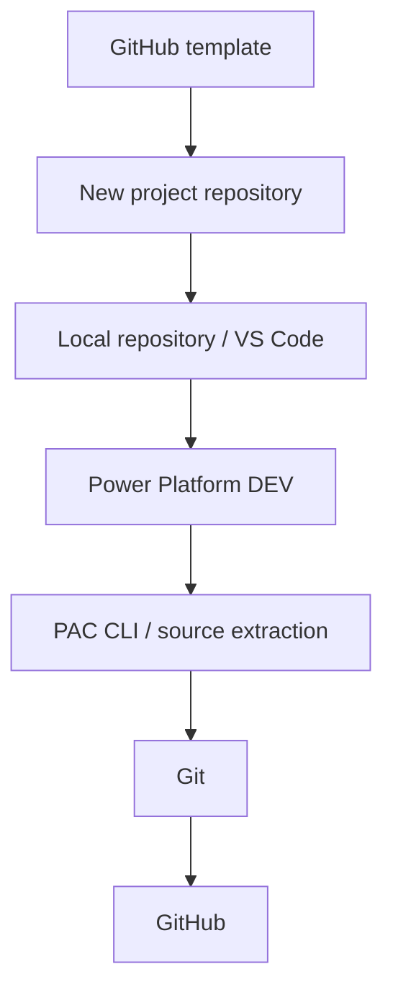
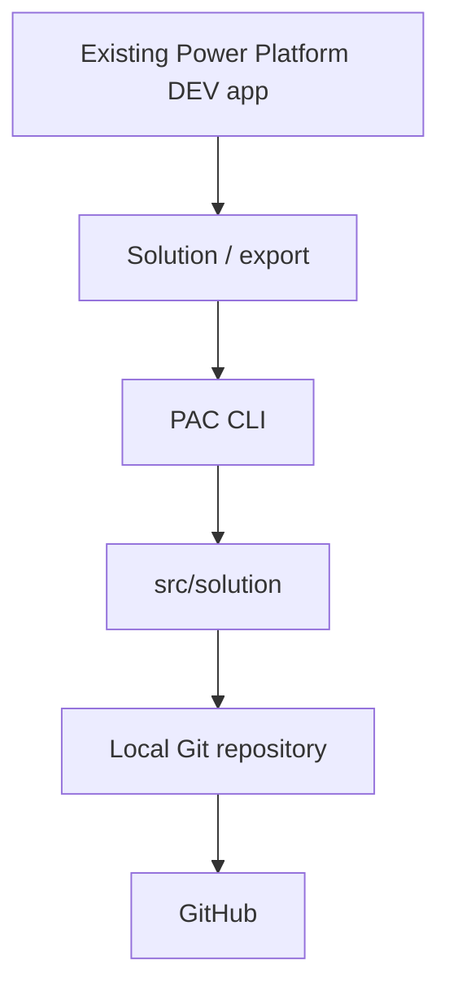
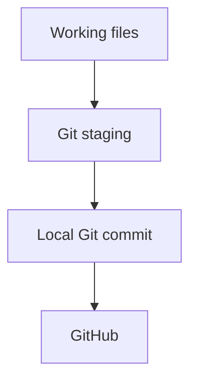
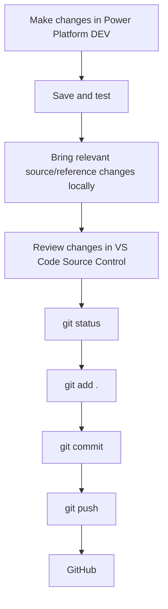

# Development workflow

Power Apps is where you build and test the live application.
VS Code is where you review local files; Git records their history and GitHub keeps a shared copy.
Start small: there is no automated deployment in this template.

## Know the different areas

| Area | Purpose |
| --- | --- |
| Live Power Platform application | The application running in a Power Platform environment; editing a local reference file does not change it. |
| Exported Power Platform solution | A ZIP package exported from Power Platform containing the solution's included components, not a backup of all external data or dependencies. |
| `src/solution/` | Unpacked Power Platform solution source used with PAC CLI and Git. |
| `src/canvas-yaml/` | Clean readable screen/component YAML and important Power Fx for reference, review, Git history, and Copilot assistance. Screen and component YAML can later live directly here. |
| `src/canvas-yaml/app/` | Application-level formulas in `App.OnStart.fx` and `App.Formulas.fx`. |
| `working/input/` | Temporary Power Fx, control YAML, partial screen YAML, or other snippets supplied for troubleshooting. |
| `working/output/` | Temporary proposed corrections/results; also a convenient ignored location for local solution ZIPs. |

The application formula files start with comments only; this template contains no screens, components, or application logic.
Manually maintained reference files do **not** magically synchronise with Power Apps or with unpacked solution files.
Review changes and manually apply approved reference fixes in Power Apps, then save and test.

`src` means preserve by default; `working` means safe to experiment.
Git ignores temporary contents of `working/input/` and `working/output/`, retaining only their `.gitkeep` placeholders.
Ignored files are not backups: do not keep your only important copy there or force-add temporary files.
Never include passwords, tokens, connection secrets, or sensitive business data in shared files/snippets.

## Starting a new application

1. On GitHub, use this template to create a **new project repository**, rather than building the application in the template repository.
2. Clone the new repository to your computer (GitHub's **Code** menu provides its URL); open that local folder in VS Code.
3. Fill in [Project overview](project-overview.md) and [Business rules](business-rules.md).
4. Build, save, and test the application in your Power Platform DEV environment.
5. When ready to track solution source, include the app and relevant components in an unmanaged solution in DEV, then export and unpack it using PAC CLI as described below.
6. Preserve useful, deliberately maintained Canvas YAML/Power Fx references separately under `src/canvas-yaml/`; review local changes, commit with Git, and push to GitHub.



## Bringing an existing application into Git

1. Create a project repository from this template, clone it, and open it in VS Code.
2. Record the existing application's purpose, data sources, and rules in `docs/`.
3. In the existing DEV environment, find or create an unmanaged solution and add the existing Canvas App and relevant dependencies; do not recreate the app.
4. Save and test the app, export the solution, and use PAC CLI to unpack it into `src/solution/`.
5. Optionally preserve selected readable YAML and important Power Fx under `src/canvas-yaml/`, keeping their reference role clear.
6. Review the files, commit the initial source snapshot locally, and push it to GitHub.



**Solution prerequisite:** this workflow uses a DEV environment with Dataverse available for solutions, appropriate permissions, and any required licences.
That does not mean your Canvas App must use Dataverse for its business data: it can still use SharePoint or other sources.
If your existing app is not in a solution-capable environment or cannot be added to a solution, confirm the supported route with your administrator before following the solution commands.
You can still track deliberately maintained reference material separately.
Exports do not automatically include external SharePoint data, credentials, or every dependency; record what the project needs.

## PAC CLI: the small command set

Install Git, VS Code, and [Microsoft Power Platform CLI](https://learn.microsoft.com/en-us/power-platform/developer/cli/introduction) first; the Microsoft Power Platform Tools extension for VS Code is one installation option.
Open a terminal at the **project repository root**, where `README.md` is located.
Commands below use paths relative to that root and show one unmanaged DEV solution.
Run only the commands you need, not the whole section blindly.

Replace every `<...>` placeholder, including the angle brackets:
- `<ENVIRONMENT_URL>`: the actual DEV environment URL from Power Platform; do not guess it.
- `<SOLUTION_UNIQUE_NAME>`: the solution's **unique name**, not its display name, from the solution details.
- `<EXPORT_ZIP_PATH>`: your chosen local ZIP path under `working/output/`.
- `<PACKED_ZIP_PATH>`: a **different** local ZIP path under `working/output/`, so the exported package is not overwritten.

The path placeholders are local files you choose, not environment IDs.
Keep quotes around replacement values.

### Check authentication

```text
pac auth list
```
Lists saved authentication profiles and marks the active one; no placeholders to replace.
A saved profile does not guarantee its sign-in is still valid.

### Authenticate when needed

```text
pac auth create --environment "<ENVIRONMENT_URL>"
```
Signs you in and creates an active authentication profile for the DEV environment; replace `<ENVIRONMENT_URL>` with your actual DEV URL.
Complete the interactive sign-in; never put credentials in these files.

### View available environments

```text
pac org list
```
Lists environments available to the signed-in account; no placeholders to replace.

### Select the DEV environment

```text
pac org select --environment "<ENVIRONMENT_URL>"
```
Selects the environment for the active authentication profile; replace `<ENVIRONMENT_URL>` with the actual DEV URL.
Confirm the selected environment is DEV before exporting.

### Export an unmanaged solution

```text
pac solution export --name "<SOLUTION_UNIQUE_NAME>" --path "<EXPORT_ZIP_PATH>" --managed false
```
Exports the named unmanaged solution to a local ZIP; replace `<SOLUTION_UNIQUE_NAME>` and `<EXPORT_ZIP_PATH>` as defined above.
Save and publish the intended DEV changes first, and use a fresh ZIP filename for a new export.

### Unpack solution source

```text
pac solution unpack --zipfile "<EXPORT_ZIP_PATH>" --folder "src/solution" --packagetype Unmanaged
```
Extracts the unmanaged solution ZIP into the source folder for review and Git history; replace `<EXPORT_ZIP_PATH>` with the ZIP you exported.
Keep `"src/solution"` unchanged for this template.
Before repeating an extraction, commit or otherwise preserve existing local work and review the resulting changes, including components removed from the live solution.
Unpacking here does not populate or update the separate `src/canvas-yaml/` reference files.

### Pack only when needed

```text
pac solution pack --zipfile "<PACKED_ZIP_PATH>" --folder "src/solution" --packagetype Unmanaged
```
Builds an unmanaged solution ZIP from local source; replace `<PACKED_ZIP_PATH>` with your separate output ZIP path.
Keep `"src/solution"` unchanged.
Packing does **not** import, deploy, or change any live environment, and it does not include separately maintained `src/canvas-yaml/` files.
Do not treat the packed ZIP as permission to overwrite an environment; deployment is outside this beginner workflow.

For current options, see Microsoft's [auth](https://learn.microsoft.com/en-us/power-platform/developer/cli/reference/auth), [org](https://learn.microsoft.com/en-us/power-platform/developer/cli/reference/org), and [solution](https://learn.microsoft.com/en-us/power-platform/developer/cli/reference/solution) command references.

## Git basics

Run these commands from the project repository root.
Cloning the GitHub project normally sets up the remote connection; GitHub authentication is separate from PAC authentication.
Before your first commit, Git may ask you to configure your author name and email.



Staging means selecting changes for the next snapshot.
A commit saves that snapshot **locally**; pushing sends commits to GitHub.
The “working files” in this diagram means local repository changes in general, not specifically the ignored `working/` folders.

| Command | Plain-English meaning |
| --- | --- |
| `git status` | Shows changed files and what is staged; normally ignored temporary files do not appear. |
| `git add .` | Stages all non-ignored changes under the current folder, including deletions; review first to avoid adding unwanted files. |
| `git commit -m "Describe the change"` | Records the staged changes locally; replace `Describe the change` with a short meaningful description. |
| `git pull` | Downloads and integrates updates from the tracked GitHub branch; use at the start of work with a clean working tree. |
| `git push` | Uploads your local commits to the tracked GitHub branch. |

These commands have no other placeholders to replace.
If pull/push reports conflicts or divergent history, stop and understand the message before proceeding; do not force-push or discard work to make it disappear.

## Normal daily development

Start with a clean local working tree and `git pull` to get any shared changes.
Then:



Use the commit command with a meaningful message as shown above.
For solution changes, export and unpack the relevant solution; for manual reference changes, deliberately copy the approved YAML/Power Fx.
Review exactly what will be committed, including unexpected generated files or sensitive data.
This process records changes; it does not deploy from Git or automatically overwrite Power Platform.

## Troubleshooting with Copilot

```text
Power Apps
  → copy problematic Power Fx / YAML into working/input
  → Copilot analyses / fixes
  → proposed correction in working/output when useful
  → you review
  → you manually apply the approved change
```

Copilot may edit temporary input files when asked to troubleshoot them.
Asking to “check”, “review”, “fix this Power Fx”, or “troubleshoot” does **not** authorise changes to original files in `src/canvas-yaml/`.
Copilot should analyse first, show a small proposed Power Fx replacement in its response, or put a larger proposed YAML correction in `working/output/`.
Clearly ask to apply/edit/change the original source when you actually want that source modified.
After manually applying a fix in Power Apps, save and test it before deliberately updating any maintained source/reference snapshot.
